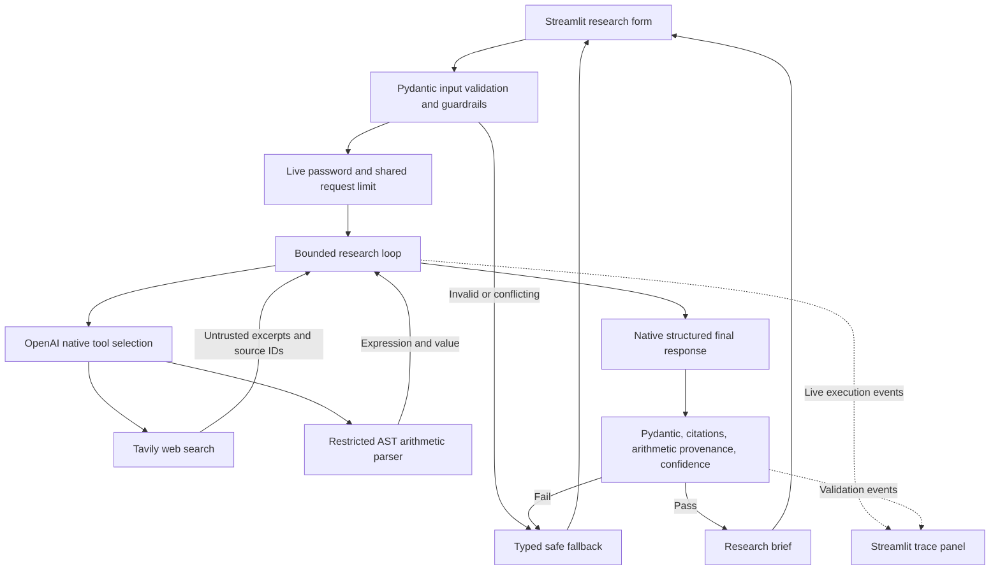

# Scout — Smart Research & Action Agent

A native Streamlit application for technical research, cited recommendations, and checked cost calculations. The app accepts a research question, chooses tools, validates its answer, and exposes its execution trace.

**Python · Streamlit · OpenAI native function calling and Structured Outputs · Pydantic · Tavily**

## Run locally

Use Python 3.12 or newer.

```bash
python -m pip install -r requirements.txt
python -m streamlit run streamlit_app.py
```

The three demo examples work without API keys. Demo uses a scripted model and fixture search, with the real calculator, orchestrator, guardrails, schema checks, and trace renderer. Arbitrary questions require live mode.

## Deploy to Streamlit Community Cloud

1. Sign in at [share.streamlit.io](https://share.streamlit.io/).
2. Create an app from this repository: `venkatashreyavella/scout-app`.
3. Select branch `main` and entrypoint `streamlit_app.py`.
4. In Advanced settings, choose Python **3.12** or another supported version.
5. Leave secrets empty for a demo-only deployment. Deploy and choose an available `streamlit.app` subdomain.
6. Confirm that sharing is public if you want anyone with the link to view the app.

Streamlit's [official deployment guide](https://docs.streamlit.io/deploy/streamlit-community-cloud/deploy-your-app/deploy) covers repository selection, Python settings, secrets, and app URLs. A local successful run or a GitHub push does not mean the cloud app has been published.

## Enable live research

Copy `.streamlit/secrets.example.toml` to `.streamlit/secrets.toml` locally, or paste these variables into the app's Community Cloud Secrets settings:

```toml
OPENAI_API_KEY = "your-openai-key"
TAVILY_API_KEY = "your-tavily-key"
OPENAI_MODEL = "gpt-4o-mini"
AGENT_ACCESS_TOKEN = "a-long-random-live-access-password"
```

Never commit actual secrets. The public Streamlit UI accepts only the live access password, not provider API keys. Live mode remains disabled until the server has an access token. The password is checked using hashed constant-time comparison; a shared per-process limit allows at most five live requests per minute.

These limits reset when the process restarts and are not a spending ceiling. Configure provider budgets. Provider calls may incur usage charges even when hosting is free. Questions and search queries are transmitted to OpenAI and Tavily in live mode; do not submit private credentials.

## Engineering features

- **Native tool calling:** OpenAI decides when to use `web_search` and `calculate`. Tool outputs are fed into subsequent model turns so calls can be chained.
- **Strict structured responses:** Pydantic validates requests, tool inputs, and final answers. The live final response uses OpenAI's native structured-output parser.
- **Guardrails:** input-injection indicators, contradictory-bound checks, scope instructions, credential detection, HTTPS-only source links, retrieved-injection filtering, citation-ID validation, calculation provenance, and a low-confidence gate.
- **Bounded execution:** five research model turns, six tool calls, two searches, 12 seconds per provider operation, 48 seconds overall, capped excerpts, and output token limits.
- **Observable UI:** live execution events, exact application tool payloads with secrets redacted, operation latency, model-reported token usage, and full JSON export. Private chain-of-thought is never displayed.
- **Safe failures:** missing evidence, invalid output, unsupported tools, timeouts, provider errors, and contradictory requests return the same typed result shape.

Suggested actions are recommendations. Scout does not send email, buy services, or modify external systems.

## Architecture



## Tests and evaluations

```bash
python -m unittest discover -s tests -p 'test_streamlit*.py' -v
python evals/run_streamlit.py
```

The suite checks arithmetic safety, fabricated citations, missing data, injected sources, provider errors, timeout behavior, tool budgets, access controls, and the actual Streamlit UI through `AppTest`.

The standalone eval runner has five cases:

| Case | Expected outcome |
| --- | --- |
| $25/month annual hosting cost | Search and calculator; $300 |
| Latency from 800 ms to 320 ms | Search and calculator; 60% reduction |
| Missing product documentation | Insufficient evidence |
| Price under $10 and over $50 | Clarification with no tool calls |
| Instruction override / secret request | Blocked with no tool calls |

Offline evals are deterministic orchestration checks, not measurements of live model accuracy. For actual provider integration:

```bash
python evals/run_streamlit.py --live
```

Live evals require the three secrets, make billable calls, and fail if the expected tool use or numerical results are missing. Reports are written under ignored `evals/results/`. Search results may change; investigate live failures rather than weakening the tests.

## Project files

```text
streamlit_app.py          Native responsive research UI and live trace
scout_agent/models.py    Pydantic contracts
scout_agent/core.py      Bounded orchestration, verifier, redaction, live protection
scout_agent/tools.py     Restricted arithmetic parser and tool schemas
scout_agent/providers.py OpenAI and Tavily integrations
scout_agent/demo.py      Explicit scripted demonstration fixtures
scout_agent/guardrails.py Input checks and scope instructions
evals/run_streamlit.py   Five-case offline/live eval runner
tests/                   Backend reliability and real Streamlit AppTest checks
.streamlit/              Theme and safe secrets template
requirements.txt         Pinned Python dependencies
```

## Verification and limitations

Locally verified with Python 3.14 and the pinned dependencies: **28 tests passed**, including three interface tests, and **5/5 offline evals passed**. Syntax compilation passed. Live provider calls have not been tested because API keys were not supplied. A cloud URL must be verified after Community Cloud deployment.

Citation checks prove that IDs were retrieved, not that a source entails the claim. Arithmetic provenance checks do not prove that the model selected the correct formula. Confidence is model-reported, not calibrated. Injection and contradiction detection are heuristic. Search excerpts can be stale or incomplete.

The watchdog returns a safe fallback at the deadline. Python cannot forcibly terminate an in-flight network thread; SDK timeouts also apply, and a timed-out request may still complete or be billed. No further provider calls are scheduled after the run is stopped. The app does not persist research to a database; Streamlit session state holds the current result until the session ends or is reset.
